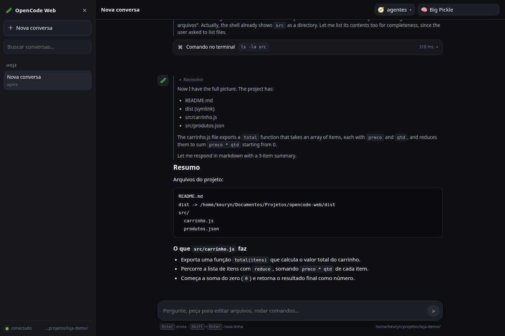
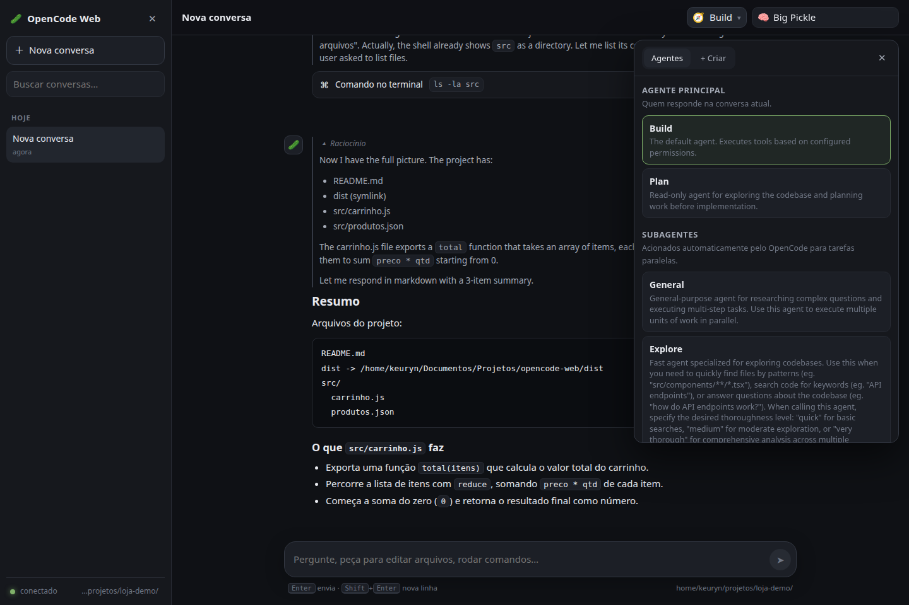
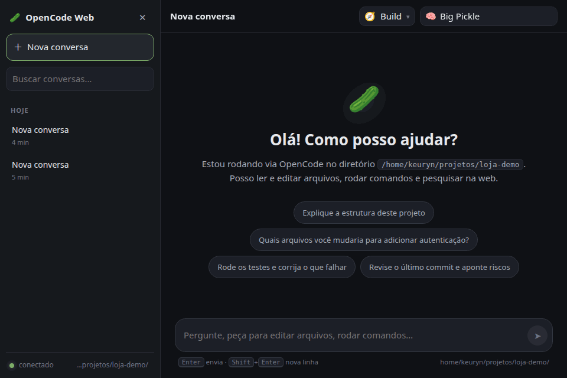

# OpenCode Web 🥒

[](https://github.com/Keuyn/opencode-web/actions/workflows/ci.yml)
[](LICENSE)
[](package.json)

Interface de chat no estilo ChatGPT para conversar com o agente do **OpenCode** direto no
navegador — incluindo leitura/escrita de arquivos, execução de comandos, busca na web,
permissões, formulários e streaming em tempo real.

O aplicativo não fala com nenhum provedor de LLM diretamente: ele usa a **API HTTP do
serviço do OpenCode** que já roda na sua máquina. Por isso a autenticação, os provedores,
os modelos, as ferramentas, os agentes e o histórico de sessões são exatamente os mesmos
que você já usa no terminal.

```
navegador  ──►  server.ts (Express)  ──►  serviço do OpenCode (127.0.0.1)
  React          proxy autenticado          sessões, modelos, ferramentas
  @opencode/client   + Vite (dev)           SSE de eventos
```

## Capturas







## Requisitos

- Node.js 20+ (testado com 22)
- OpenCode instalado e com o serviço em execução (`opencode service status`). Se não
  estiver rodando, o servidor da interface inicia um automaticamente.

## Como rodar

```sh
npm install

# desenvolvimento (hot reload da interface)
npm run dev
# → http://127.0.0.1:3123

# produção (build + servidor único)
npm run build
npm start
# → http://127.0.0.1:3123
```

Variáveis de ambiente: `PORT` (padrão `3123`) e `HOST` (padrão `127.0.0.1`, ou seja,
acessível apenas da sua máquina).

## O que dá para fazer

- **Conversar com streaming** — texto, raciocínio (bloco recolhível), markdown completo e
  blocos de código com botão de copiar.
- **Ferramentas visíveis** — cada chamada de ferramenta aparece como um cartão com ícone,
  resumo (arquivo, comando, URL…), entrada e saída expansíveis, duração e status
  (executando / concluído / erro).
- **Permissões** — quando o agente precisa de autorização, aparece um cartão com
  *Permitir uma vez*, *Permitir sempre* e *Recusar*.
- **Perguntas do agente (formulários)** — campos de texto, número, seleção e múltipla
  escolha, respondidos direto na interface.
- **Histórico de sessões** — lista agrupada por data, busca, renomear, excluir e retomar
  qualquer conversa (mesmas sessões do terminal). Conversas longas carregam as 200
  mensagens mais recentes e um botão no topo traz as anteriores sem perder a posição.
- **Modelo e agente** — seletor no cabeçalho. O modelo padrão é o `opencode/big-pickle`
  quando disponível; trocar o modelo usa a API de switch da sessão.
- **Painel de agentes** — o botão 🧭 no cabeçalho abre um painel com:
  - os **agentes principais** (Build, Plan e os personalizados) para escolher com um clique;
  - os **subagentes** disponíveis (Explore, General…);
  - **Rodando agora** — quais agentes/subagentes o OpenCode está executando no momento
    (indicador com contador no botão). Dá para abrir um subagente em andamento e voltar;
  - **Criar agente** — formulário que grava o agente no `opencode.json` do projeto
    (nome, descrição, modo e prompt do sistema) e recarrega o serviço automaticamente,
    no estilo do `opencode agent create`. Agentes personalizados podem ser removidos
    pelo ✕ na lista.
- **Mensagem durante a execução (steer)** — se você enviar uma mensagem enquanto o agente
  ainda está trabalhando, por padrão ele **lê na hora** (delivery `steer`), sem esperar a
  execução atual terminar. O alternador *Agora / Fila* no compositor permite escolher
  enviar na hora ou enfileirar para depois; mensagens na fila aparecem acima do campo de
  texto, com opção de cancelar ou antecipar.
- **Interromper** — botão *Parar* envia `session.interrupt` e o streaming para na hora.
- **Diretório de trabalho** — por padrão é o diretório onde o servidor foi iniciado
  (mostrado no rodapé da barra lateral). Clique nele para trocar de pasta: as sessões,
  ferramentas e permissões passam a valer para o novo diretório.

## Estrutura

```
server.ts                    servidor Express: /app/config, /app/agents (criar/remover
                             agentes no opencode.json) + proxy streaming para a API
index.html                   entrada do Vite
src/main.tsx                 bootstrap (cria o cliente e conecta o stream de eventos)
src/App.tsx                  layout (barra lateral + chat)
src/lib/store.ts             estado da aplicação, redução dos eventos SSE e ações
src/lib/types.ts             tipos do domínio da interface
src/lib/format.ts            tempo, tokens, resumo de ferramentas
src/components/*             Sidebar, Header, AgentPanel, ChatView, Message, ToolCard,
                             Composer, PermissionCard, FormCard, Markdown
scripts/smoke-store.ts       teste de integração do reducer (sem navegador)
scripts/smoke-dom.mjs        teste de renderização do bundle real dentro do jsdom
```

### Detalhes de integração

- O navegador usa o cliente oficial `@opencode/client` apontando para a **mesma origem**
  (`window.location.origin`). Todas as chamadas `/api/*` são repassadas pelo `server.ts`,
  que injeta as credenciais obtidas via `Service.discover()` / `Service.headers()`.
- O stream de eventos (`GET /api/event`, SSE) é repassado sem buffer, então o streaming é
  em tempo real.
- O diretório base vai no header `x-opencode-directory` do cliente, deixando toda a
  interface limitada ao projeto escolhido.
- O estado é mantido fora do React e notificado em lotes por `requestAnimationFrame`, o
  que evita re-renderizar a cada token recebido.

## Teste rápido

Com o servidor de desenvolvimento rodando:

```sh
npm run smoke
```

O script sobe o store real em Node (sem React), cria uma sessão, pede ao agente para
listar arquivos com o shell e imprime o resultado do reducer — incluindo cartões de
ferramenta, tokens e status. A sessão usada no teste é removida no final.

Para conferir a interface montada de verdade (com o `npm run build` já executado):

```sh
npm run smoke:dom
```

Ele carrega o bundle de produção dentro do jsdom, confere marca, lista de sessões,
seletor de modelo, histórico, cartões de ferramenta, markdown e raciocínio, abre o painel
de agentes (seções e formulário de criação) e depois envia uma mensagem real, verificando
a resposta do assistente.

## Agentes personalizados

O botão **+ Criar** no painel de agentes grava a definição em `opencode.json` na raiz do
projeto (o arquivo é criado se não existir), no formato aceito pelo OpenCode:

```json
{
  "agents": {
    "revisor": {
      "description": "Revisa diffs antes do commit",
      "mode": "primary",
      "system": "Você revisa alterações e aponta riscos."
    }
  }
}
```

Depois de gravar, o servidor chama o reload de configuração do serviço, então o agente
aparece na hora no seletor — sem reiniciar nada. Se já existir um `opencode.json` (ou
`.opencode/opencode.json`) com outros ajustes, eles são preservados; arquivos `.jsonc`
são lidos com suporte a comentários.

> Observação: o relatório de "rodando agora" usa `session.active()` e as sessões-filhas
> (`parentID`) da conversa atual, atualizadas por eventos e por um polling leve a cada 5s.

## Problemas comuns

| Sintoma | Causa provável |
| --- | --- |
| Faixa "offline" no rodapé | Serviço do OpenCode parado: `opencode service restart` |
| `openai_unreachable` / 502 nas respostas | Mesmo caso acima; o proxy tenta redescobrir a porta automaticamente |
| Modelo listado mas resposta falha | Provedor/modelo sem credencial configurada no OpenCode |
| Nada acontece ao enviar | Verifique o painel de permissões ou o log do terminal onde o `npm run dev` roda |

## Licença

Distribuído sob a licença [MIT](LICENSE). © 2026 Keuyn.
